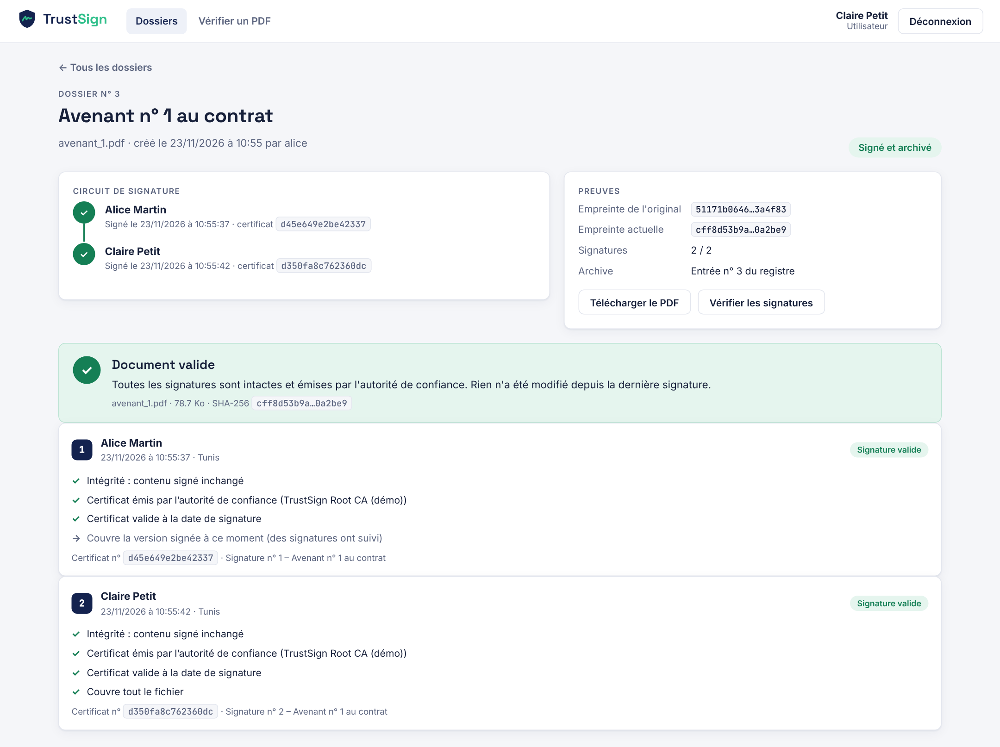
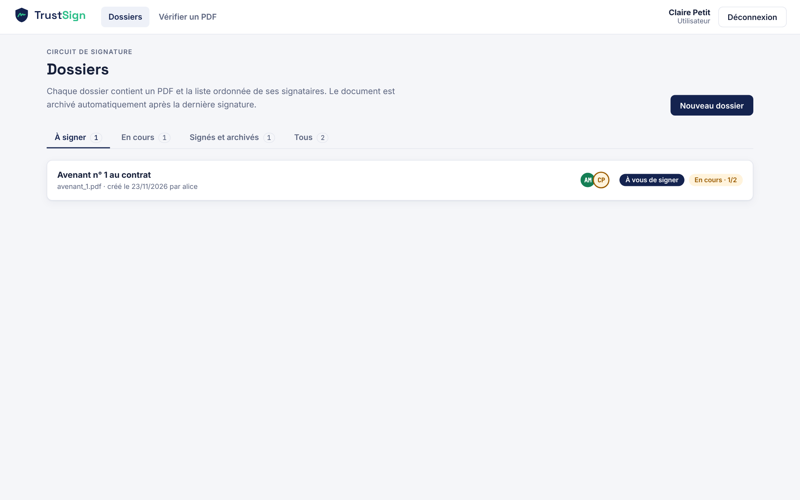
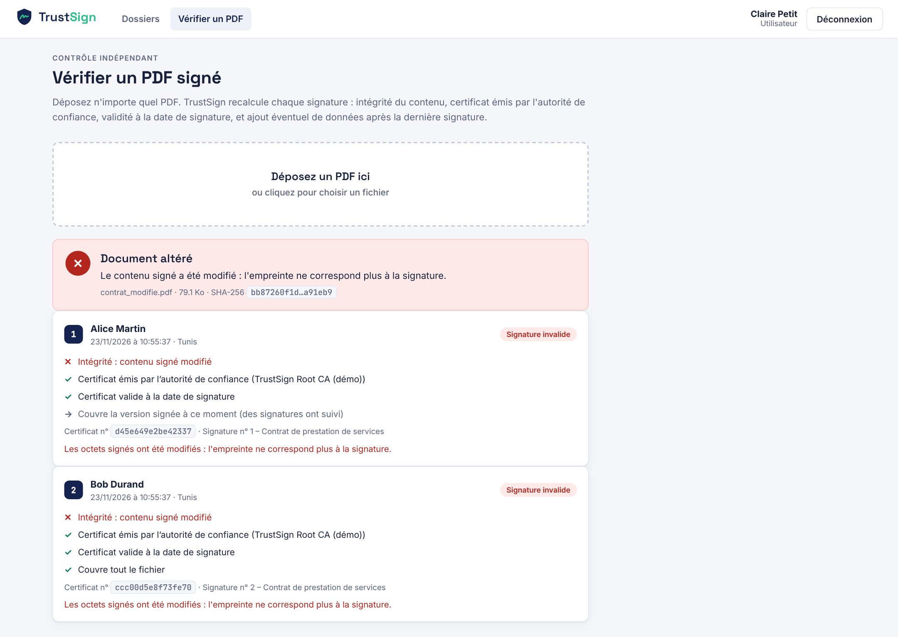
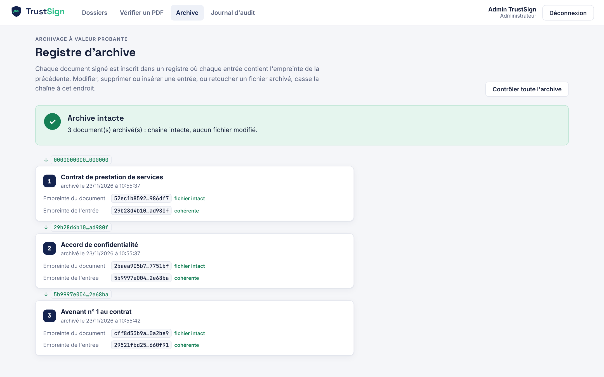
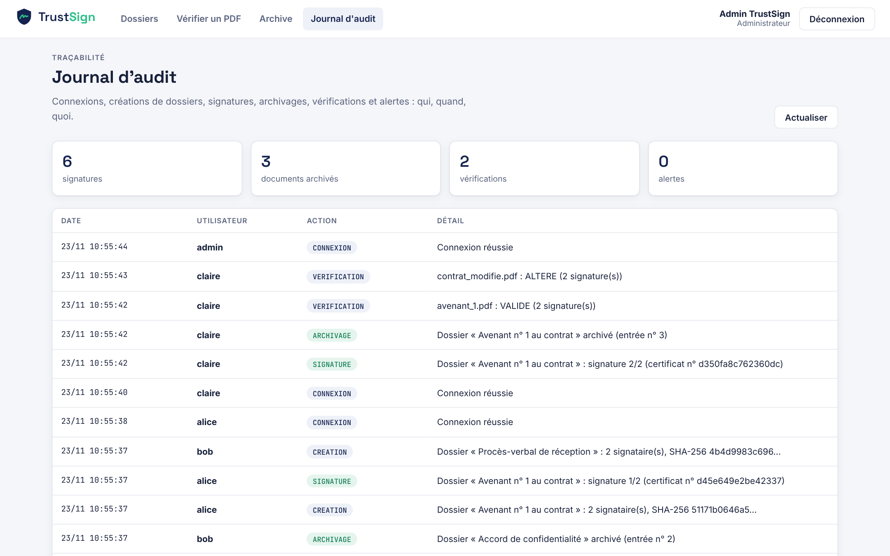
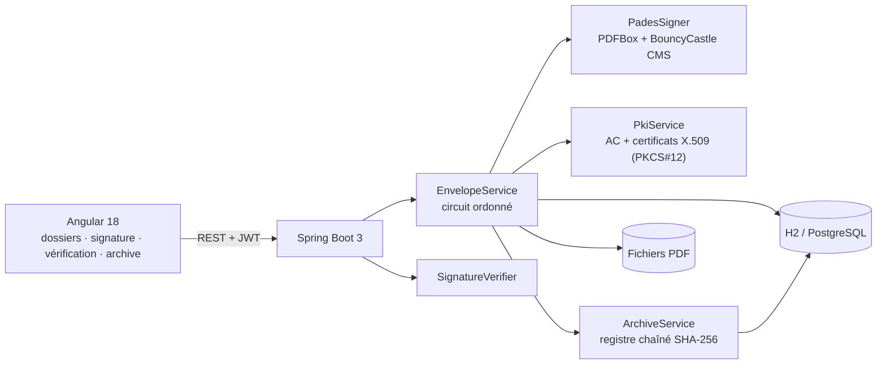

# 🛡️ TrustSign — Signature électronique PAdES et archivage à valeur probante


TrustSign est une plateforme de **circuit de signature électronique** pour des documents PDF :

- on crée un dossier ;
- on désigne les signataires dans un **ordre imposé** ;
- chacun appose une **signature PAdES** réelle (certificat X.509 + CMS), intégrée dans le PDF ;
- une fois le dossier complet, le document est **archivé dans un registre chaîné** (SHA-256). Ce registre rend toute falsification détectable.

Un module de **vérification indépendante** contrôle n'importe quel PDF signé : intégrité, certificat, ajout de données après signature.

> Projet personnel inspiré des métiers de la **confiance numérique** : signature électronique, archivage probant, intégrité documentaire.



## ✨ Fonctionnalités

| | |
|---|---|
| ✍️ **Signature PAdES B-B** | `ETSI.CAdES.detached`, SHA-256 / RSA, attribut *signing-certificate-v2*, sauvegarde **incrémentale** : chaque signature préserve les précédentes. |
| 🔢 **Circuit ordonné** | Le serveur impose l'ordre des signataires (`403 « Ce n'est pas encore votre tour »`). Seuls les participants voient le dossier. |
| 🏛️ **PKI interne** | AC racine (RSA 3072) et certificats signataires (RSA 2048, *nonRepudiation*) générés et stockés en PKCS#12. |
| 🔍 **Vérification** | Pour chaque signature : intégrité CMS, certificat émis par l'AC de confiance, validité à la date de signature, couverture du fichier. Verdicts : `VALIDE`, `ALTERE`, `MODIFIE_APRES_SIGNATURE`, `NON_FIABLE`, `AUCUNE_SIGNATURE`. |
| ⛓️ **Archive chaînée** | `hash(n) = SHA-256(position ‖ hash(n-1) ‖ dossier ‖ titre ‖ sha256(document) ‖ date)`. Modifier, supprimer ou insérer une entrée, ou retoucher un fichier archivé, casse la chaîne à cet endroit. |
| 🔐 **Sécurité** | JWT, rôles USER / ADMIN (`@PreAuthorize`), en-têtes CSP, contrôle de l'empreinte du fichier stocké avant chaque signature. |
| 📜 **Journal d'audit** | Connexions, créations, signatures, vérifications, contrôles d'archive. |

### Validation indépendante
Les PDF produits sont reconnus par un outil tiers, **`pdfsig` (Poppler)** :

```
Signature #1: - Signature Type: ETSI.CAdES.detached - Signature Validation: Signature is Valid.
```

*(« issuer isn't trusted » est attendu, puisque l'AC de démonstration n'est pas dans le magasin de confiance du système.)*

## 🖼️ Captures

| Dossiers | Document altéré détecté |
|---|---|
|  |  |
| **Registre d'archive chaîné** | **Journal d'audit** |
|  |  |

## 🏗️ Architecture



## 🚀 Lancer

Prérequis : **JDK 17**. L'interface Angular est déjà compilée dans le backend.

```bash
cd backend
./mvnw spring-boot:run        # Windows : mvnw.cmd spring-boot:run
```

Ouvrir **http://localhost:8081**. Quatre dossiers de démonstration sont chargés au démarrage.

| Compte | Mot de passe | Rôle |
|---|---|---|
| `alice` / `bob` / `claire` | `alice123` / `bob123` / `claire123` | Signataires |
| `admin` | `admin123` | Archive + audit |

Avec Docker : `docker compose up --build`.

Tests : `cd backend && ./mvnw test`. Les **18 tests** couvrent la signature, la falsification d'octets, l'ajout après signature, une AC étrangère, l'ordre du circuit, les droits d'accès et la falsification de l'archive.

## ⚖️ Limites (démo honnête)
- **AC de démonstration** : en production, on utiliserait des certificats qualifiés eIDAS / ANCE.
- **Les clés sont conservées par le serveur** : cela correspond à une *signature à distance*. En production, elles seraient dans un **HSM**.
- **Pas encore d'horodatage RFC 3161** (PAdES B-T) ni de données de validation à long terme (B-LT / LTV).
- La vérification utilise une seule ancre de confiance, sans contrôle CRL ni OCSP.

## 👨‍💻 Auteur
**Rached ILAHI**, élève ingénieur en génie informatique, ENICarthage
[GitHub](https://github.com/Rached12364) · voir aussi [TrustDoc](https://github.com/Rached12364/TrustDoc), un assistant documentaire RAG avec intégrité et audit.
